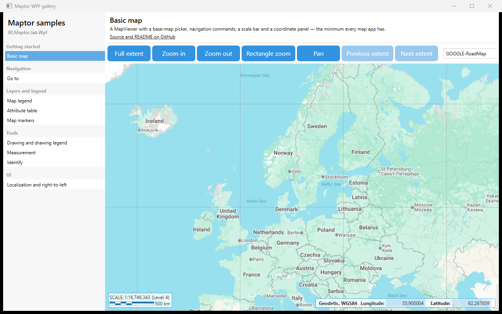

# IRI.Maptor.Samples.Wpf.Gallery

One window, one page per `IRI.Maptor.Presentation.Wpf` feature. The navigation list on the left is built
from `Shell/SampleCatalog.cs`; each page is a `UserControl` in its own folder under `Samples/`,
with a README that explains it and links to the source.



## Samples

| Page | Folder | Shows |
|---|---|---|
| Basic map | [Samples/BasicMap](Samples/BasicMap/README.md) | Navigation commands, base-map picker, `Scalebar`, `CoordinatePanelView` |
| Go to | [Samples/GoTo](Samples/GoTo/README.md) | `GoToCommand` dialog and `GoToView` hosted inline |
| Map legend | [Samples/MapLegend](Samples/MapLegend/README.md) | `MapLegendView`, in-memory `VectorLayer`, add shapefile / GeoJSON |
| Attribute table | [Samples/AttributeTable](Samples/AttributeTable/README.md) | `FeatureTabControl`, `SelectedLayer`, opening a table from code |
| Map markers | [Samples/MapMarkers](Samples/MapMarkers/README.md) | `SpecialPointLayer`, `Locateable`, built-in markers, a custom command |
| Drawing and drawing legend | [Samples/DrawingLegend](Samples/DrawingLegend/README.md) | Draw commands, `MapDrawingLegendView`, `SketchBarView` |
| Measurement | [Samples/Measurement](Samples/Measurement/README.md) | `MeasureLengthCommand`, `MeasureAreaCommand` |
| Identify | [Samples/Identify](Samples/Identify/README.md) | `IdentifyModeCommand`, Identify results window |
| Delaunay and Voronoi | [Samples/DelaunayVoronoi](Samples/DelaunayVoronoi/README.md) | `DelaunayTriangulation`, `VoronoiDiagram`, clipping unbounded cells |
| Day and night | [Samples/DayNight](Samples/DayNight/README.md) | `DayNightDataSource` + `DayNightLayers` twilight overlay, `MapClock` + `MapClockBinding` (live / play / fixed time), `Sun.GetSolarDay` at a clicked place |
| Satellite positions | [Samples/SatellitePosition](Samples/SatellitePosition/README.md) | `TleReader`/`OmmJsonReader`, `Sgp4Propagator`, `SatellitesDataSource` (track, footprint, swath), `SatelliteLayers` (click to choose), `PassFinder` (visible / imaged passes over a region), deep space (GPS, Galileo, geostationary), `ElementStore` + CelesTrak groups, `MapTimeBar` |
| Theme and controls | [Samples/ThemeAndControls](Samples/ThemeAndControls/README.md) | Every design-system token over a live accent + light/dark switch; `ThemeHelper`, `FollowWindowsMode` |
| Localization and right-to-left | [Samples/Localization](Samples/Localization/README.md) | `LanguageCombo`, `LocalizationManager` bindings, `FlowDirection` |

## How a page is built

Every page is a `UserControl` that owns its own `MapViewer` and initializes it in `Loaded`,
exactly like [HelloMap](../IRI.Maptor.Samples.Wpf.HelloMap/README.md) does in its window:

```csharp
var presenter = new GalleryMapViewModel();                         // empty MapViewModelBase subclass
presenter.InitializeSettings(ProxySettings.Default, BaseMapSettings.Default,
    new MapSettings { InitialExtent = BoundingBoxes.WebMercator_Europe }, GeneralSettings.Default);
await MapInitializationHelper.InitializeMapAsync(map, Window.GetWindow(this)!, presenter);
DataContext = presenter;
presenter.SelectedMapProvider = TileMapProviderFactory.GoogleRoadMap;
```

The shell (`MainWindow`, `Shell/`) lists the pages, grouped by category with an icon each. You can search them by title, category or description (Ctrl+F; Esc clears, Down moves into the list). The shell hosts the selected page under a header with its category, title, description and a *View source* link, and has a light/dark switch at the bottom of the navigation. It only lists and hosts pages; a page never
references the shell, so a sample folder can be copied into your own application as is. The one
shared file is `Shell/GalleryMapViewModel.cs` — three lines — used by the pages that need no
commands of their own.

### Shared page chrome

`App.xaml` defines the few styles every page uses, so the pages look alike and a change there
reaches them all. They sit on the Maptor design-system tokens (`IRI.Maptor.Styles.*`):

| Style | For |
|---|---|
| `SampleToolbarHost` (Border) + `SampleToolbar` (StackPanel) | The command strip at the top of a page, divided from the map by a hairline |
| `SampleToolbarButton` | Its buttons: outlined, default height |
| `SampleSidePanel` | A panel docked beside the map |
| `SampleHint` | Secondary text: usage hints and status lines |

Floating panels use `SampleMapCard` when they hold inputs (theme surface) and `SampleMapReadout` when they are read-outs (on-map palette). `Shell/MapTimeBar` holds the time controls of a `MapClock` (readout, date, months, Now / Live / Play, speed and a 24-hour timeline). It is shared by the samples with time-dependent layers.

Panels that float over the map use the on-map palette (`IRI.Maptor.Brushes.OnMap.*`) when they are
read-outs, and the theme surface when they hold inputs; see the Day and night page.

## How to run

```bash
dotnet run --project samples/IRI.Maptor.Samples.Wpf.Gallery
```

## Adding a page

1. Create `Samples/<Name>/<Name>Sample.xaml` (+ `.xaml.cs`) and `Samples/<Name>/README.md`.
2. Add one `new(...)` line to `Shell/SampleCatalog.cs` with the category, title, description, folder and a `PackIconMaterialKind` icon.
3. Put commands in `<Border Style="{StaticResource SampleToolbarHost}"><StackPanel Style="{StaticResource SampleToolbar}">…`.

---
[Back to the samples index](../README.md)
