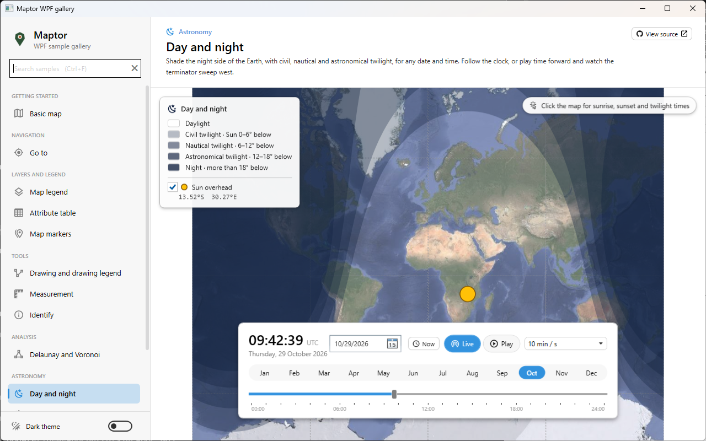

# Day and night

Shades the night side of the Earth on a Web Mercator map for any date and time, with the three
twilight bands in between. The sample starts **Live**, following the clock. Drag the timeline,
pick a date, or press **Play** (or Space) to run time forward at a chosen speed and watch the
terminator sweep west. The legend card also shows where the Sun is straight overhead.

To compare seasons, click a **month** in the strip above the timeline. The date moves to that month, keeping the day and the time of day; a day the month doesn't have becomes its last day, so 31 January becomes 28 February. Hover over March, June, September or December to see the equinox or solstice in it. To watch a whole year go by, choose **1 week / s** and press Play.

**Click anywhere on the map** to open the Sun panel for that place (a drag still pans). It shows:
- the light right now, as day, civil, nautical or astronomical twilight, or night, with the Sun's height and direction;
- a chart of the Sun's height through the local day;
- sunrise and sunset with their compass directions, solar noon and its height, and the day length;
- the three twilights;
- a banner when the place has midnight sun or polar night.

A place's real time zone can't be known offline, so the times can be shown in three zones: the place's own zone from its longitude (whole hours), this computer's zone, or UTC. Esc closes the panel.



## What it shows

- `DayNightDataSource` (Core.Persistence) is the overlay's data. Each band is the region where the
  Sun is below a limit: −0.83° (sunset), −6°, −12° and −18°. The bands are nested caps around the
  anti-solar point, built by `SphericalCapHelper` (Core.Spatial), so a cap over a pole or across the
  antimeridian comes out right.
- `DayNightLayers.Create(source)` (Presentation.Wpf) makes one `VectorLayer` for it:
  - The caps are drawn on top of each other with the same translucent fill, so the shading
    deepens from twilight to night with no polygon holes.
  - The translucency is in the brush colour, not the layer opacity. That is what lets overlaps add up.
- The time bar is `Shell/MapTimeBar`, shared with the Satellite positions sample. Give it a clock with `timeBar.Clock = clock` and it both shows and drives it.
- `MapClock` (Presentation.Core) is one shared map time. It has three modes:
  - **live**: follows the clock;
  - **playing**: runs forward at a speed;
  - **fixed**: you set the time.

  Its ticks arrive on the UI thread. The Satellite positions sample uses the same clock.
- `MapClockBinding` (Presentation.Wpf) follows the clock. On each tick it sets `source.Time` and redraws the layer in place, so the layer keeps its legend row. A burst of ticks, such as dragging the timeline, gives one redraw.
- `Sun.GetSubSolarPoint(time)` (Core.Astronomy) gives the point with the Sun at the zenith.
- `Sun.GetSolarDay(place, date, utcOffset)` and `Sun.GetPhase(place, time)` fill the Sun panel (`SunInfoPanel.xaml`). Missing events, such as no sunrise during polar night, come back as `null`, never as NaN.

## The essential code

```csharp
var source = new DayNightDataSource { IncludeSubSolarPoint = true };
var layer = DayNightLayers.Create(source);
presenter.AddLayer(layer);

var clock = new MapClock { IsLive = true };          // create it on the UI thread
var binding = new MapClockBinding(presenter, layer, clock, time => source.Time = time);

// after changing an option, such as source.IncludeSubSolarPoint:
binding.Refresh();
```

## Accuracy

The Sun's position is good to about 0.01°. The overlay treats the Earth as a sphere and samples
it every 1° of longitude, so the drawn terminator is within about 0.2° of the true one. That is
invisible at world scale. Near the poles the map stops at ±85.05°, as Web Mercator does.
