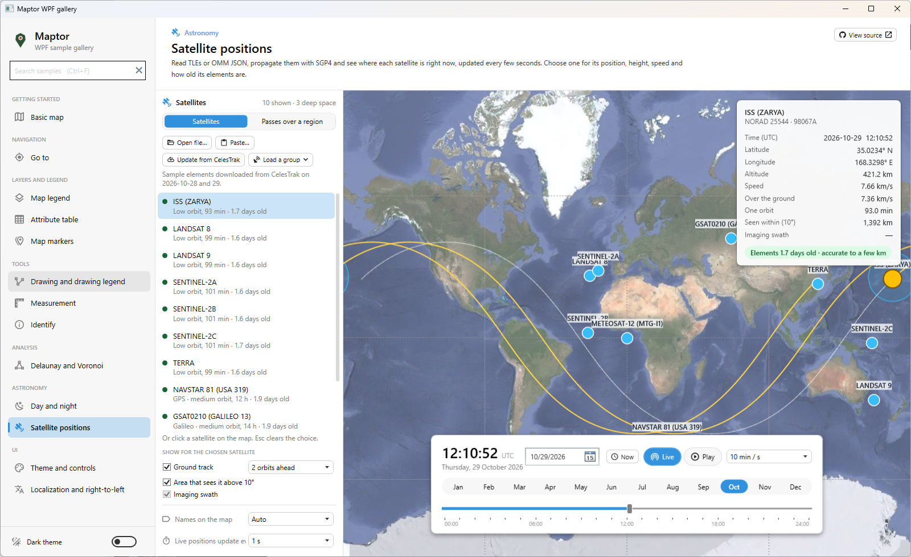
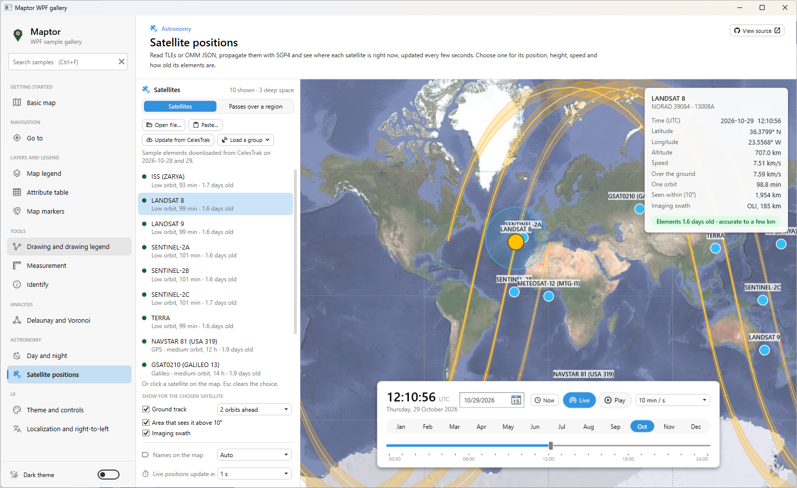

# راهنمای کاربری موقعیت ماهواره‌ها (Satellite Positions – User Guide)

## راهنمای کاربر برای نمونهٔ «Satellite positions»

| | |
|---|---|
| **برنامه** | `Maptor Gallery` |
| **نمونه** | `Satellite positions` |
| **تاریخ** | ۷ آبان ۱۴۰۵ |

این راهنما برای کاربر نمونهٔ «Satellite positions» در برنامهٔ Maptor Gallery نوشته شده است و توضیح می‌دهد هر بخش صفحه چه می‌کند و چگونه از آن استفاده کنید. توضیح فنی و کد نمونه در پروندهٔ `README.md` کنار نمونه آمده است.

رابط کاربری برنامه انگلیسی است؛ در این راهنما نام هر دکمه و گزینه همان‌طور که روی صفحه دیده می‌شود میان «» آمده و معنی فارسی آن در کنارش نوشته شده است.

## ۱- این نمونه چه می‌کند

نشان می‌دهد هر ماهواره هم‌اکنون بالای کدام نقطهٔ زمین است. برنامه عناصر مداری هر ماهواره (`TLE`) را می‌خواند، مدار آن را با الگوریتم `SGP4` محاسبه می‌کند و هر چند ثانیه نقطهٔ زیر ماهواره را روی تصویر ماهواره‌ای نقشه دوباره می‌کشد. با نوار زمان می‌توانید به گذشته یا آینده بروید، و با زبانهٔ دوم می‌توانید بفهمید یک ماهواره کی از بالای یک منطقه می‌گذرد.

### ۱-۱ باز کردن نمونه

1. برنامهٔ Maptor Gallery را اجرا کنید.
2. در کادر جست‌وجوی بالای فهرست سمت چپ، `satellite` را بنویسید یا در فهرست روی «Satellite positions» کلیک کنید.
3. نمونه با ده ماهوارهٔ آماده باز می‌شود.

ماهواره‌های اولیه:

| ماهواره | نوع |
|---|---|
| `ISS` | ایستگاه فضایی بین‌المللی |
| `Landsat 8`، `Landsat 9` | تصویربرداری منابع زمین |
| `Sentinel-2A`، `Sentinel-2B`، `Sentinel-2C` | تصویربرداری منابع زمین |
| `Terra` | تصویربرداری منابع زمین |
| `NAVSTAR 81` | ناوبری GPS |
| `GSAT0210` | ناوبری Galileo |
| `Meteosat-12` | هواشناسی زمین‌آهنگ |

### ۲-۱ نمای کلی صفحه

| بخش | جای آن | کار آن |
|---|---|---|
| نقشه | وسط | تصویر ماهواره‌ای زمین؛ ماهواره‌ها به صورت نقطه با نام روی آن دیده می‌شوند |
| پنل «Satellites» (ماهواره‌ها) | زبانهٔ اول پنل کنار نقشه | فهرست ماهواره‌ها، بارگذاری و به‌روزرسانی، گزینه‌های نمایش، مشخصات ماهوارهٔ انتخاب‌شده |
| پنل «Passes over a region» (گذر از بالای یک منطقه) | زبانهٔ دوم همان پنل | انتخاب منطقه و یافتن زمان‌های دیدن یا تصویربرداری |
| نوار زمان | پایین پنجره | تاریخ و ساعت نقشه؛ زنده، پخش، یا زمان دلخواه |

## ۲- فهرست ماهواره‌ها و بارگذاری داده

هر سطر فهرست نام ماهواره و نوع مدار آن را نشان می‌دهد؛ مثلاً `GPS · medium orbit, 12 h` (مدار میانی، دورهٔ ۱۲ ساعته) یا `Low orbit, 93 min` (مدار پایین، دورهٔ ۹۳ دقیقه‌ای)، و در پایان سطر سن عناصر مداری به روز. شمارندهٔ بالای فهرست می‌گوید چند ماهواره در فهرست است و چند تای آن‌ها «deep space» (فضای دور) هستند.

### ۱-۲ دکمه‌های بالای فهرست

- «Open file…» (باز کردن پرونده): یک پروندهٔ `TLE` (مجموعه‌های دو یا سه خطی) یا پروندهٔ `OMM JSON` سایت CelesTrak را باز می‌کند. مجموعه‌هایی که خوانده نشوند در یک نوار پیام گزارش می‌شوند و بقیه نمایش داده می‌شوند.
- «Paste…» (چسباندن): متن `TLE` را که از یک صفحهٔ وب، مثلاً CelesTrak یا Space-Track، کپی کرده‌اید می‌پذیرد.
- «Load a group» (بارگذاری یک گروه): فهرست را با یک گروه کامل از CelesTrak جایگزین می‌کند. پس از انتخاب گروه، «Load» (بارگذاری) را بزنید یا با «Cancel» (انصراف) منصرف شوید.
- «Update from CelesTrak» (به‌روزرسانی از CelesTrak): عناصر مداری تازه را برای ماهواره‌های فهرست از `celestrak.org` می‌گیرد. برنامه فقط هنگام فشردن این دکمه به اینترنت وصل می‌شود و یک نسخهٔ محلی در پوشهٔ `%LocalAppData%\IRI.Maptor\Gallery\celestrak` نگه می‌دارد.

گروه‌های قابل بارگذاری:

| گروه | محتوا |
|---|---|
| «GPS (operational)» | ماهواره‌های فعال GPS |
| «Galileo» | ماهواره‌های ناوبری اروپا |
| «Geostationary weather» | ماهواره‌های هواشناسی زمین‌آهنگ |
| «Earth resources» | ماهواره‌های منابع زمین (تصویربرداری) |
| «Space stations» | ایستگاه‌های فضایی |
| «The sample satellites» | برگشت به ده ماهوارهٔ اولیه |

### ۲-۲ رفتار به‌روزرسانی

- تا دو ساعت بعد، فشردن دوبارهٔ دکمه از همان نسخهٔ محلی استفاده می‌کند، چون CelesTrak خواسته است هر دادهٔ یکسان حداکثر هر دو ساعت یک بار دانلود شود.
- بدون اینترنت، آخرین نسخهٔ ذخیره‌شده به کار می‌رود و خط زیر دکمه‌ها این را می‌گوید.
- پرونده‌هایی که باز می‌کنید نیز در همان محل ذخیره می‌شوند.

> **توجه:** عناصر مداری کهنه می‌شوند. عناصر چندروزه تا چند کیلومتر دقت دارند؛ عناصر چندهفته‌ای فقط یک تصویر تقریبی می‌دهند. پیش از برنامه‌ریزی رصد یا تصویربرداری، «Update from CelesTrak» را بزنید.

## ۳- انتخاب یک ماهواره

- در فهرست روی ماهواره کلیک کنید، یا روی نقطهٔ آن در نقشه کلیک کنید. روی ماهواره نشانگر ماوس به شکل دست درمی‌آید و نام ماهواره در راهنمای ابزار دیده می‌شود.
- کلیک روی جای خالی نقشه انتخاب را عوض نمی‌کند. کلید `Esc` انتخاب را پاک می‌کند.
- ماهوارهٔ انتخاب‌شده روی نقشه برجسته می‌شود و زیر فهرست مشخصات آن می‌آید.

### ۱-۳ مشخصات ماهوارهٔ انتخاب‌شده

| برچسب | معنی |
|---|---|
| Time (UTC) | زمانی که موقعیت برای آن محاسبه شده (به وقت جهانی) |
| Latitude / Longitude | عرض و طول جغرافیایی نقطهٔ زیر ماهواره |
| Altitude | ارتفاع از سطح زمین |
| Speed | سرعت مداری |
| Over the ground | سرعت نقطهٔ زیر ماهواره روی زمین |
| One orbit | مدت یک دور کامل (دورهٔ تناوب) |
| Seen within (10°) | شعاع منطقه‌ای که ماهواره را بالاتر از ۱۰ درجه از افق می‌بیند |
| Imaging swath | پهنای نوار تصویربرداری سنجنده (برای ماهواره‌های تصویربردار) |

همین‌جا سن عناصر مداری هم با رنگ نشان داده می‌شود.

### ۲-۳ نمایش برای ماهوارهٔ انتخاب‌شده

در بخش «SHOW FOR THE CHOSEN SATELLITE»:

- «Ground track» (رد زمینی): مسیر نقطهٔ زیر ماهواره؛ یک مدار به عقب کم‌رنگ و ۱ تا ۳ مدار به جلو پررنگ. تعداد مدارهای جلو (۱ تا ۳) را با گزینهٔ «orbits ahead» انتخاب کنید.
- `Area that sees it above 10°` (منطقه‌ای که آن را بالاتر از ۱۰ درجه می‌بیند): هر جایی که هم‌اکنون ماهواره دست‌کم ۱۰ درجه بالاتر از افق است.
- «Imaging swath» (نوار تصویربرداری): نواری که سنجنده پوشش می‌دهد؛ Landsat حدود ۱۸۵ کیلومتر، Sentinel حدود ۲۹۰ کیلومتر و Terra حدود ۲٬۳۳۰ کیلومتر. فقط برای ماهواره‌های تصویربردار فعال می‌شود.

### ۳-۳ نام‌ها روی نقشه

گزینه‌های «Names on the map»:

- «Auto» (خودکار): تا ۵۰ ماهواره همه نام دارند؛ بیشتر از آن فقط ماهوارهٔ انتخاب‌شده.
- «All» (همه): همهٔ ماهواره‌ها نام دارند.
- «Chosen only» (فقط انتخاب‌شده): فقط ماهوارهٔ انتخاب‌شده.

### ۴-۳ فاصلهٔ به‌روزرسانی زنده

گزینهٔ «Live positions update every» با مقدارهای ۱، ۵، ۱۰ یا ۳۰ ثانیه: در حالت زنده، ساعت نقشه با این فاصله جلو می‌رود و موقعیت‌ها دوباره کشیده می‌شوند. فاصلهٔ کوتاه‌تر حرکت روان‌تری می‌دهد و پردازندهٔ بیشتری می‌خواهد.

## ۴- نوار زمان

نوار پایین پنجره با نمونهٔ «Day and night» مشترک است و همهٔ زمان‌ها به وقت جهانی (`UTC`) هستند.

| کنترل | کار آن |
|---|---|
| «Now» (اکنون) | پرش به زمان فعلی |
| «Live» (زنده) | دنبال کردن ساعت رایانه |
| «Play» (پخش) | جلو بردن زمان با سرعت انتخاب‌شده؛ کلید `Space` هم پخش و توقف می‌کند |
| سرعت پخش | «1 min / s»، «10 min / s»، «1 h / s»، «1 day / s»، «1 week / s»: هر ثانیهٔ واقعی برابر یک دقیقه، ده دقیقه، یک ساعت، یک روز یا یک هفته |
| انتخاب تاریخ | تاریخ (`UTC`) را از تقویم بردارید |
| نوار ماه‌ها | کلیک روی یک ماه، تاریخ را به همان روز از آن ماه می‌برد |
| خط زمان ۲۴ ساعته | ساعت روز را بکشید؛ کلیدهای جهت یک دقیقه و `Page Up` / `Page Down` یک ساعت جابه‌جا می‌کنند |

خط زمان را بکشید تا ببینید یک ماهواره کجا بوده یا کجا خواهد بود. با هر تغییر زمان، نقطه‌ها، رد زمینی و منطقهٔ دید دوباره محاسبه می‌شوند. دکمهٔ «Live» شما را به زمان جاری برمی‌گرداند.

> **توجه:** همهٔ زمان‌های برنامه به وقت جهانی (`UTC`) است. وقت ایران سه ساعت و نیم جلوتر از `UTC` است.

## ۵- گذر از بالای یک منطقه

به زبانهٔ دوم پنل، «Passes over a region»، بروید.

### ۱-۵ منطقه را مشخص کنید

در بخش «REGION»:

- «Point» (نقطه): یک بار روی نقشه کلیک کنید.
- «Rectangle» (مستطیل): روی نقشه بکشید.
- «Polygon» (چندضلعی): روی گوشه‌ها کلیک کنید و با دوبار کلیک تمام کنید.
- دکمهٔ حذف، منطقه و گذرهای آن را پاک می‌کند.

منطقه با حاشیهٔ سرخابی روی نقشه کشیده می‌شود. تا منطقه‌ای انتخاب نشده پیام «No region yet» دیده می‌شود.

### ۲-۵ نوع جست‌وجو را انتخاب کنید

در بخش «FIND»:

- «Visible» (قابل دیدن): زمان‌هایی که هر ماهوارهٔ فهرست، از جایی در منطقه، بالاتر از حداقل ارتفاع زاویه‌ای است. حداقل ارتفاع زاویه‌ای را با «Minimum elevation» از میان ۰ درجه (افق)، ۱۰، ۲۰ یا ۳۰ درجه انتخاب کنید؛ مقدار بالاتر یعنی فقط گذرهای بلندتر و بهتر. برای منطقهٔ نقطه‌ای، جهت طلوع و غروب ماهواره هم گفته می‌شود.
- «Imaged» (تصویربرداری‌شده): زمان‌هایی که نوار تصویربرداری Landsat، Sentinel یا Terra به منطقه می‌رسد، همراه با سهمی از منطقه که پوشش داده می‌شود. فقط ماهواره‌هایی با سنجندهٔ شناخته‌شده جست‌وجو می‌شوند.

### ۳-۵ بازهٔ زمانی را انتخاب کنید

جست‌وجو از زمان نوار زمان شروع می‌شود و به اندازهٔ گزینهٔ «From the time bar, for» جلو می‌رود: ۲۴ ساعت، یا ۳، ۷ یا ۱۴ روز. اگر می‌خواهید از زمان دیگری شروع شود، اول نوار زمان را روی آن بگذارید.

### ۴-۵ جست‌وجو کنید

«Find passes» (یافتن گذرها) را بزنید. جست‌وجو در پس‌زمینه انجام می‌شود و با «Cancel» قابل لغو است.

### ۵-۵ خواندن نتیجه‌ها

- هر سطر نام ماهواره، زمان شروع گذر (`UTC`)، مدت آن و جهت حرکت را می‌گوید: برای منطقهٔ نقطه‌ای جهت طلوع و غروب (مثلاً «SW → NE»)، و برای منطقهٔ پهن «northbound» (رو به شمال) یا «southbound» (رو به جنوب). گذری که پیش از شروع بازه آغاز شده با «under way» (در جریان) مشخص می‌شود.
- عدد سمت راست سطر، در جست‌وجوی «Visible» بیشترین ارتفاع زاویه‌ای گذر و در جست‌وجوی «Imaged» درصد منطقه‌ای است که تصویربرداری می‌شود.
- نماد چشم: گذر با چشم غیرمسلح دیده می‌شود، یعنی ماهواره در نور خورشید است و آسمان بالای منطقه تاریک است.
- نماد خورشید یا ماه (در جست‌وجوی تصویربرداری): منطقه در روز است یا شب. سنجندهٔ نوری به نور روز نیاز دارد.
- روی یک گذر کلیک کنید: نوار زمان به اوج آن گذر می‌پرد، ماهوارهٔ آن انتخاب می‌شود و بخشی از رد زمینی که در آن گذر طی می‌شود با رنگ سبز پررنگ کشیده می‌شود.

## ۶- انواع مدار و رفتار آن‌ها

- مدار پایین (`ISS`، Landsat، Sentinel، Terra): هر ۹۰ تا ۱۰۰ دقیقه یک دور می‌زنند؛ رد زمینی آن‌ها موجی است و هر گذر چند دقیقه طول می‌کشد.
- GPS و Galileo (مدار میانی): رد زمینی بلند و پهنی دارند که هر روز (GPS) یا هر ده روز (Galileo) تکرار می‌شود، و منطقهٔ دید بسیار بزرگی دارند.
- ماهوارهٔ زمین‌آهنگ (`Meteosat-12` و گروه هواشناسی): بالای یک نقطه ثابت می‌ماند. در فهرست گذرها یک بار و با عنوان «In view all the time» (همیشه در دید) همراه با جهت و ارتفاع زاویه‌ای ظاهر می‌شود.

## ۷- نکته‌ها و محدودیت‌ها

- اینترنت فقط برای دو چیز لازم است: دانلود عناصر تازه از CelesTrak و بارگذاری کاشی‌های نقشه. محاسبهٔ موقعیت‌ها و گذرها کاملاً آفلاین است.
- دقت به سن عناصر مداری بستگی دارد.
- ماهواره‌ای که از مدار خارج شده یا عناصرش قابل محاسبه نیست نمایش داده نمی‌شود.
- جست‌وجوی چهارده‌روزه با گروه‌های بزرگ (مثلاً همهٔ GPS) چند ثانیه طول می‌کشد؛ در این مدت می‌توانید با نقشه کار کنید یا جست‌وجو را لغو کنید.
- نزدیک قطب‌ها نقشه، مانند هر نقشهٔ وب‌مرکاتور، در عرض ±۸۵ درجه تمام می‌شود.

## ۸- میانبرهای صفحه‌کلید

| کلید | کار |
|---|---|
| `Space` | پخش / توقف زمان |
| `Esc` | پاک کردن انتخاب ماهواره |
| کلیدهای جهت (روی خط زمان) | یک دقیقه جلو یا عقب |
| `Page Up` / `Page Down` (روی خط زمان) | یک ساعت جلو یا عقب |
| دوبار کلیک (هنگام رسم چندضلعی) | پایان رسم |

