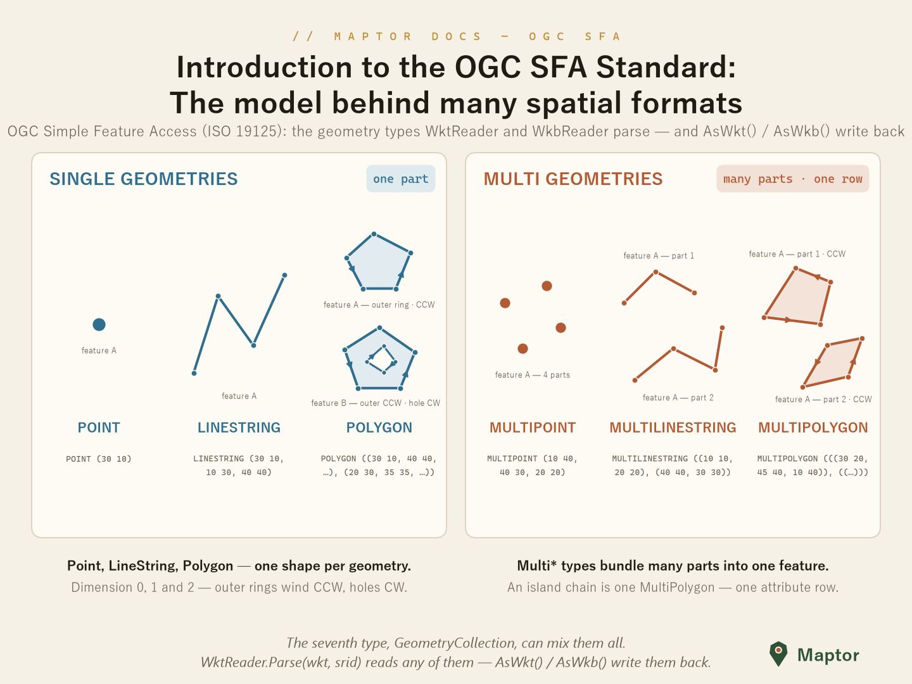
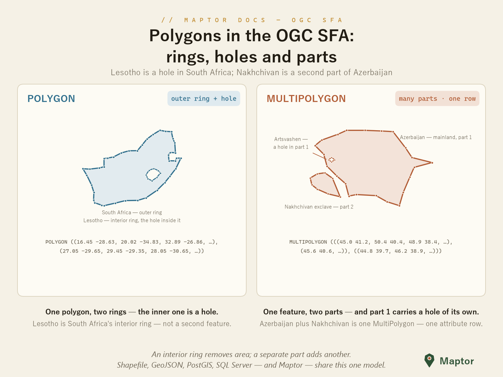
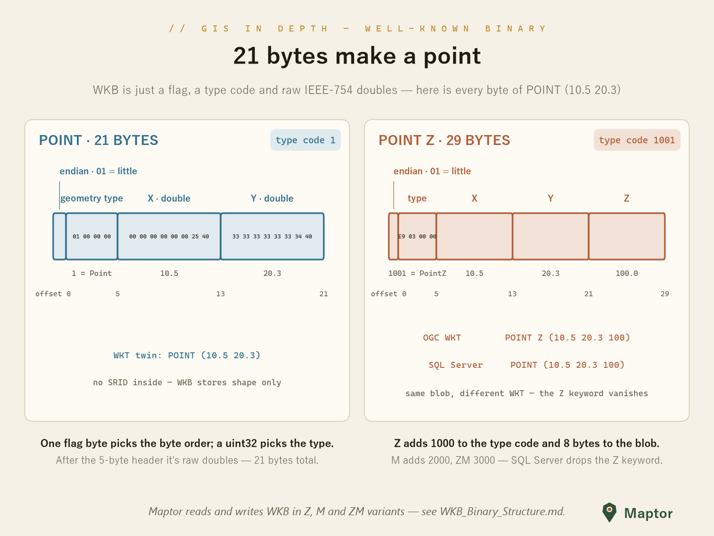

# WKT and WKB (OGC Simple Features)

OGC Simple Feature Access (ISO 19125) serialization for `Geometry<T>` — one geometry model, three encodings: OGC Well-Known Text, Well-Known Binary, and SQL Server's WKT dialect.

## Supported capabilities

| Capability | Supported |
|---|---|
| OGC WKT read | Yes — `WktReader.Parse` |
| OGC WKT write | Yes — `geometry.AsWkt()` |
| WKB read | Yes — `Geometry<T>.FromWkb` / `WkbReader.Parse` |
| WKB write | Yes — `geometry.AsWkb()` |
| PostGIS EWKB read | Yes — same `FromWkb` / `WkbReader.Parse` (detected automatically) |
| PostGIS EWKB write | Yes — `geometry.AsEwkb()` |
| SQL Server WKT read | Yes — `SqlServerWktReader.Parse` |
| SQL Server WKT write | Yes — `geometry.AsSqlServerWkt()` |
| Z / M / ZM dimensions | Yes (WKT dimension suffixes) |

<p align="center">
  
</p>

A polygon's rings carry two different meanings: an interior ring is a hole in the same polygon, while a second exterior ring is a separate part of a MultiPolygon.

<p align="center">
  
</p>

## Usage

### WKT — Well-Known Text

`WktReader` parses OGC-compliant WKT, including the `Z` / `M` / `ZM` dimension suffixes; `AsWkt()` writes it back.

```csharp
using IRI.Maptor.Core.Spatial.IO.OgcSFA;

var geometry = WktReader.Parse("POINT Z (1 2 3)", srid: 4326);

string wkt = geometry.AsWkt();   // "POINT Z (1 2 3)"
```

### WKB — Well-Known Binary

The compact binary twin: one byte-order flag, a `uint32` geometry type, then raw `double` coordinates.

<p align="center">
  
</p>

```csharp
byte[] wkb = geometry.AsWkb();               // POINT: 21 bytes = order(1) + type(4) + x(8) + y(8)

var restored = Geometry<Point>.FromWkb(wkb, srid: 4326);
```

Byte-level layout of every geometry type: [WKB_Binary_Structure.md](WKB_Binary_Structure.md).

### The PostGIS dialect (EWKB)

PostGIS sends and receives `geometry`/`geography` values as EWKB. Instead of the ISO `+1000`/`+2000`/`+3000` type offsets, EWKB sets flags in the type code: `0x80000000` for Z, `0x40000000` for M and `0x20000000` for an embedded SRID. When the SRID flag is set, an `int32` SRID follows the type code. The reader accepts both forms, in either byte order. An SRID embedded in EWKB takes precedence over the `srid` argument.

```csharp
byte[] ewkb = geometry.AsEwkb();             // SRID=4326;POINT: 25 bytes = order(1) + type(4) + srid(4) + x(8) + y(8)

var restored = Geometry<Point>.FromWkb(ewkb, srid: 0);   // restored.Srid == 4326
```

`AsEwkb()` embeds the SRID only when it is positive, and it always writes little-endian output. The output matches PostGIS's `ST_AsEWKB(g, 'NDR')` byte for byte.

### The SQL Server dialect

SQL Server writes WKT **without** dimension suffixes — the dimension is inferred from the coordinate count (`POINT (1 2 3)` instead of OGC's `POINT Z (1 2 3)`). `SqlServerWktReader` / `AsSqlServerWkt()` speak that dialect, so converting is a read in one and a write in the other:

```csharp
var g = SqlServerWktReader.Parse("POINT (1 2 3)");

string ogc = g.AsWkt();            // "POINT Z (1 2 3)"
string sql = g.AsSqlServerWkt();   // "POINT (1 2 3)"
```

Full comparison (dimension detection, MULTIPOINT nesting, when to use which): [WKT_SqlServer_Differences.md](WKT_SqlServer_Differences.md).

## The OGC object model

The interchange types the WKB layer is built around — `OgcPoint`, `OgcLineString`, `OgcPolygon`, the `Multi*` classes and the `WkbGeometryType` enum — live in the `IRI.Maptor.Core.Ogc.SFA` namespace of the [IRI.Maptor.Core.Ogc](../../../IRI.Maptor.Core.Ogc/SFA) project.

---
[Back to IRI.Maptor.Core.Spatial](../../README.md)
